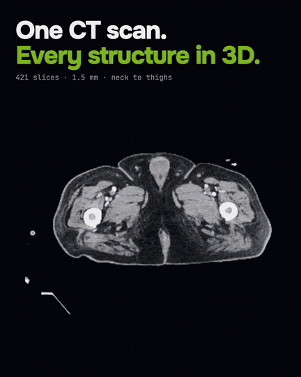

# One CT scan → every structure in 3D

**NVIDIA NV-Segment-CT (VISTA3D) segments up to 117 anatomical structures in one CT scan on a single
RTX 5060 Ti (16 GB), and the result becomes a 3D model you can orbit. Checked on 20 CT scans that were published
after the model, against expert-reviewed masks.**



| Measured on 20 unseen CT scans | |
|---|---|
| Agreement with the reference masks | **median Dice 0.917** over 1,840 structure checks, 58 % ≥ 0.90 |
| Time per scan, TensorRT (load → labels in the original CT grid) | **4.0–66.7 s**, median 10.4 s |
| Same, PyTorch AMP | 4.4–69.0 s, median 11.4 s |
| Peak GPU memory | 12.7 GB |

> Research demo, not a medical device.

## Why these 20 scans are a fair test

NV-Segment-CT was trained on TotalSegmentator **v2** (1,228 CTs, among other datasets). TotalSegmentator **v3**
(Zenodo, 10 Sept 2026, CC BY 4.0) added 711 new CTs. The test set is 20 of those new scans with trunk coverage
(16 adults, 4 adolescents aged 16–17; abdomen-pelvis, chest-abdomen-pelvis and whole-body trauma scans up to 1.8 m long),
picked at random (`data/test_cases.csv`, seed 0). The model could not have seen them.

The reference masks are TotalSegmentator's: model-assisted and reviewed by experts, not drawn from scratch. A
structure is scored only if it is in the reference with at least 1,000 voxels (3.4 ml), so a scan that stops at
the pelvis is not punished for "missing" the brain.

Weakest structures (median Dice): kidney cysts (0.20 and 0.45, only 1 and 3 cases), humerus (0.62 / 0.68, often cut by
the edge of the field of view), right common carotid (0.76) and left subclavian artery (0.77). Adults: median 0.931 per
scan; the 4 adolescents: 0.868.

**TensorRT is not always faster here.** Median speed-up is only 1.1×: PyTorch AMP is already fast on this network
(84 ms per 128³ window vs 77 ms for the engine). On all 11 scans up to 525 slices TensorRT is 1.08–1.12× faster.
On the 9 long whole-body trauma scans (598–1,230 slices) it is a toss-up: slower on 6 of them, by up to 23 %
(s1872: 40.6 s vs 33.0 s). The likely reason: the engine holds VRAM, the stitching budget shrinks, the scan is split
into more z-slabs and more windows are recomputed.

## Pipeline

```
CT (NIfTI) -> resample 1.5 mm, crop, intensity window (as the official pipeline)
  -> NV-Segment-CT "segment everything": 117 class prompts, 128^3 sliding window (25 % overlap)
     image encoder + decoder as one TensorRT 11 FP16 engine, class head in PyTorch
  -> fp16 logit sum on the GPU -> argmax -> label map back in the original CT grid
  -> vtkSurfaceNets3D (all labels in one pass) -> decimate -> GLB -> Three.js / Remotion
```

| File | What it does |
|---|---|
| `setup.sh` | venv: torch 2.15 cu132, MONAI 1.6.1, TensorRT 11.4 |
| `fetch_data.py` | pulls single cases out of the 37 GB Zenodo zip with HTTP Range requests |
| `segment.py` | inference, `--trt` for TensorRT, `--stitch monai` for the reference path |
| `eval.py`, `results.py` | Dice per structure, summary → `results/results.json` |
| `mesh.py`, `slices.py` | 3D meshes and CT slices for the video |
| `video/` | Remotion + Three.js explainer, 4:5 and 9:16 |

## Engineering notes

1. **The 117-class logit buffer.** MONAI's sliding window keeps an fp32 buffer of 117 × volume. For a whole-body CT
   that is over 16 GB, so it falls back to host memory and the GPU idles. Here the logits are summed in fp16 on the
   GPU; dividing by the window count changes neither the sign nor the argmax, so it is skipped. Very long scans are
   done in z-slabs that each use every window touching them. Same Dice; on the 421-slice neck-to-thighs hero scan s1922 the run goes from 26 s (MONAI stitching) to 11 s (PyTorch).
2. **TensorRT 11 is strongly typed.** There is no FP16 builder flag any more, so MONAI's `trt_compile(precision="fp16")`
   fails. The encoder is cast to FP16 before the ONNX export instead.
3. **InstanceNorm made the first engine 10× slower than PyTorch.** Over a 48 × 128³ feature map TensorRT built a
   reduction with one block per channel (836 ms per window vs 84 ms in PyTorch). Rewriting the mean as "reduce W
   first, then D and H" gives it enough parallel work: 77 ms. Dice is unchanged (max difference 0.0036).
4. **Zenodo throttles many small requests and gives ~0.2 MB/s per connection.** All files of one case sit next to
   each other in the zip, so each case is one Range request split into 16 parallel parts (~3.5 MB/s).

## Run it

```bash
./setup.sh                                   # Ubuntu, NVIDIA GPU with 16 GB, CUDA 13 driver
.venv/bin/python fetch_data.py meta v3       # reads the zip index once (~3 min)
.venv/bin/python fetch_data.py cases v3 s1922
.venv/bin/python segment.py data/v3/s1922/ct.nii.gz --trt --out out/pred
.venv/bin/python eval.py out/pred s1922
.venv/bin/python mesh.py out/pred/s1922.nii.gz out/hero
```

## Credits and licences

- Model: [NVIDIA NV-Segment-CT](https://huggingface.co/nvidia/NV-Segment-CT) (VISTA3D), NVIDIA Open Model License;
  downloaded at run time, not redistributed here. He et al., *VISTA3D: A Unified Segmentation Foundation Model for
  3D Medical Imaging*, CVPR 2025.
- Framework: [MONAI](https://monai.io) (Apache-2.0), TensorRT.
- Data: [TotalSegmentator dataset v3](https://zenodo.org/records/22688904), CC BY 4.0. Wasserthal et al.,
  *TotalSegmentator: Robust Segmentation of 104 Anatomic Structures in CT Images*, Radiology: AI 2023.
- Code in this repository: MIT.

Zalkarbek Arapbaev · physician & CV engineer
